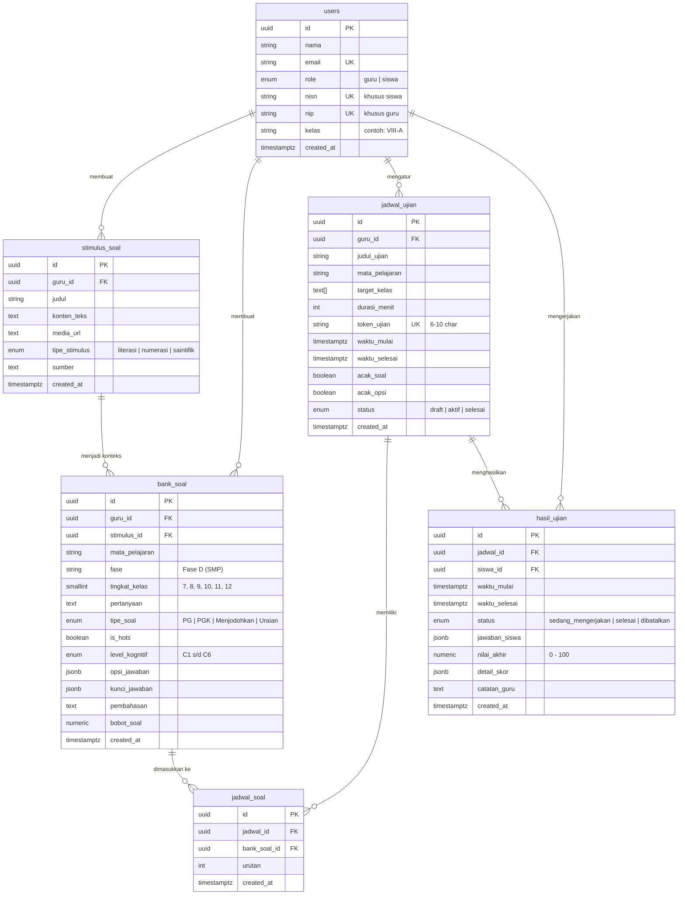

# Supabase Database Architecture: CBT AKM & HOTS (Fase D SMP & SMA)

Dokumentasi arsitektur basis data PostgreSQL / Supabase untuk platform **CBT (Computer-Based Test) Asesmen Kompetensi Minimum (AKM) & Soal HOTS (Higher-Order Thinking Skills)** yang diselaraskan dengan standar **Kurikulum Merdeka (Fase D: SMP Kelas 7-9 & Fase E/F: SMA)**.

---

## 1. Diagram Relasi Entitas (ERD)



---

## 2. Struktur Tabel & Spesifikasi Data

### 2.1. `users`
Menyimpan profil pengguna CBT baik Guru maupun Siswa.
- `id` (UUID PK): Menggunakan UUID v4, terhubung opsional ke `auth.users(id)`.
- `nama` (VARCHAR 150): Nama lengkap pengguna beserta gelar untuk guru.
- `email` (VARCHAR 255 UNIQUE): Alamat email terdaftar.
- `role` (ENUM: `'guru'`, `'siswa'`): Peran akses di dalam sistem CBT.
- `nisn` (VARCHAR 20 UNIQUE NULLABLE): Nomor Induk Siswa Nasional untuk akun siswa.
- `nip` (VARCHAR 30 UNIQUE NULLABLE): Nomor Induk Pegawai untuk akun guru.
- `kelas` (VARCHAR 20 NULLABLE): Rombongan belajar siswa (misal `'VII-A'`, `'VIII-A'`, `'VIII-B'`).

### 2.2. `stimulus_soal`
Pusat bacaan literasi panjang, tabel data numerasi, grafik, dan infografis. Dirancang untuk konsep **1 stimulus banyak butir pertanyaan**.
- `id` (UUID PK): ID unik stimulus.
- `guru_id` (UUID FK): Guru pembuat stimulus.
- `judul` (VARCHAR 255): Judul wacana/infografis.
- `konten_teks` (TEXT): Teks narasi literasi membaca atau deskripsi konteks.
- `media_url` (TEXT): URL gambar grafik, infografis, diagram alur, atau ilustrasi soal.
- `tipe_stimulus` (ENUM: `'literasi'`, `'numerasi'`, `'saintifik'`).
- `sumber` (TEXT): Atribusi sumber terpercaya (Kemendikbudristek, Jurnal, Data Resmi).

### 2.3. `bank_soal`
Master butir soal berstandar Asesmen Nasional (ANBK) & HOTS.
- `tipe_soal` (ENUM):
  1. `PG`: Pilihan Ganda (satu opsi benar).
  2. `PGK`: Pilihan Ganda Kompleks (jawaban benar lebih dari satu / checkbox).
  3. `Menjodohkan`: Mencocokkan premis dengan target yang tepat.
  4. `Uraian`: Analisis deskriptif HOTS dengan rubrik pedoman penskoran.
- `is_hots` (BOOLEAN): Indikator apakah butir soal menuntut penalaran tingkat tinggi.
- `level_kognitif` (ENUM): `'C1_Mengingat'`, `'C2_Memahami'`, `'C3_Menerapkan'`, `'C4_Menganalisis'`, `'C5_Mengevaluasi'`, `'C6_Mencipta'`.
- `opsi_jawaban` (JSONB) & `kunci_jawaban` (JSONB): Struktur dinamis sesuai format tipe soal (detail di Bagian 3).
- `pembahasan` (TEXT): Ulasan pedagogis mengapa jawaban tersebut benar.
- `bobot_soal` (NUMERIC): Bobot proporsional untuk kalkulasi nilai.

### 2.4. `jadwal_ujian` & `jadwal_soal`
Pengelolaan sesi tes:
- `token_ujian` (VARCHAR 10 UNIQUE): Kode masuk ujian siswa (misal `"SMP001"`).
- `target_kelas` (TEXT[]): Filter kelas yang berhak mengikuti ujian (contoh: `ARRAY['VIII-A', 'VIII-B']`).
- `durasi_menit` (INT): Batas waktu pengerjaan ujian dalam menit.
- `acak_soal` & `acak_opsi` (BOOLEAN): Mengacak nomor soal dan posisi opsi untuk meminimalisir kecurangan.
- `jadwal_soal`: Tabel penghubung sesi jadwal dengan butir-butir soal yang dipilih oleh guru.

### 2.5. `hasil_ujian`
Menyimpan state pengerjaan real-time siswa dan lembar hasil akhir:
- `status` (ENUM: `'sedang_mengerjakan'`, `'selesai'`, `'dibatalkan'`).
- `jawaban_siswa` (JSONB): Key berupa `bank_soal_id` dengan nilai `{ "answer": ..., "is_ragu": false, "answered_at": ... }`.
- `nilai_akhir` (NUMERIC 5,2): Nilai skala 0 - 100 terhitung otomatis.
- `detail_skor` (JSONB): Rincian capaian nilai per kategori:
  ```json
  {
    "score_pg": 2.00,
    "score_pgk": 3.00,
    "score_menjodohkan": 3.00,
    "score_uraian": 3.50,
    "total_hots_score": 9.50,
    "total_soal": 8,
    "total_terjawab": 8,
    "total_benar": 8
  }
  ```

---

## 3. Spesifikasi Payload JSON Soal & Kunci Jawaban

### 3.1. Pilihan Ganda (PG)
```json
// bank_soal.opsi_jawaban
[
  {"id": "A", "text": "Tradisi Sasi Laut mengurangi pendapatan nelayan secara permanen."},
  {"id": "B", "text": "Tradisi Sasi Laut menjamin kelangsungan regenerasi biota laut secara periodik."},
  {"id": "C", "text": "Sasi Laut hanya berfokus pada biota teripang dan lobster."},
  {"id": "D", "text": "Tradisi adat Sasi Laut bertentangan dengan metode teknologi biorock."}
]

// bank_soal.kunci_jawaban
"B"

// hasil_ujian.jawaban_siswa[soal_id]
{
  "answer": "B",
  "is_ragu": false,
  "answered_at": "2026-11-03T01:10:00Z"
}
```

### 3.2. Pilihan Ganda Kompleks (PGK Multi-Select)
```json
// bank_soal.opsi_jawaban
[
  {"id": "A", "text": "Kawasan Raja Ampat menampung sekitar 75% jenis karang keras dunia."},
  {"id": "B", "text": "Penggunaan bom potasium adalah metode yang dianjurkan para ilmuwan."},
  {"id": "C", "text": "Teknologi biorock mempercepat pertumbuhan karang 3-5 kali lebih cepat."},
  {"id": "D", "text": "Kenaikan suhu perairan menjadi pemicu pemutihan karang (coral bleaching)."}
]

// bank_soal.kunci_jawaban
["A", "C", "D"]

// hasil_ujian.jawaban_siswa[soal_id]
{
  "answer": ["A", "C", "D"],
  "is_ragu": false,
  "answered_at": "2026-11-03T01:18:20Z"
}
```

### 3.3. Menjodohkan (Premis - Target Matching)
```json
// bank_soal.opsi_jawaban
{
  "premises": [
    {"id": "p1", "text": "Sasi Laut"},
    {"id": "p2", "text": "Teknologi Biorock"},
    {"id": "p3", "text": "Coral Bleaching"}
  ],
  "targets": [
    {"id": "t1", "text": "Fenomena pemutihan karang akibat pemanasan suhu permukaan air laut."},
    {"id": "t2", "text": "Aturan kearifan lokal suku Maya yang melarang pengambilan biota laut."},
    {"id": "t3", "text": "Metode stimulasi arus listrik tegangan rendah untuk rehabilitasi karang."},
    {"id": "t4", "text": "Teknik pembesaran kerapu di air tawar."}
  ]
}

// bank_soal.kunci_jawaban
[
  {"premise_id": "p1", "target_id": "t2"},
  {"premise_id": "p2", "target_id": "t3"},
  {"premise_id": "p3", "target_id": "t1"}
]

// hasil_ujian.jawaban_siswa[soal_id]
{
  "answer": [
    {"premise_id": "p1", "target_id": "t2"},
    {"premise_id": "p2", "target_id": "t3"},
    {"premise_id": "p3", "target_id": "t1"}
  ],
  "is_ragu": false,
  "answered_at": "2026-11-03T01:23:45Z"
}
```

### 3.4. Soal Uraian HOTS (Dengan Pedoman Penskoran)
```json
// bank_soal.opsi_jawaban (Rubrik Penskoran)
{
  "rubrik": [
    {"aspek": "Kearifan Lokal", "skor_maks": 30, "kriteria": "Menyebutkan peran kepatuhan adat."},
    {"aspek": "Biorock Modern", "skor_maks": 30, "kriteria": "Menyebutkan percepatan 3-5x laju karang."},
    {"aspek": "Sintesis Sinergi", "skor_maks": 40, "kriteria": "Mengaitkan kepatuhan adat dan efektivitas teknologi."}
  ]
}

// bank_soal.kunci_jawaban
{
  "rubrik_kunci": "Perpaduan keduanya efektif karena Sasi Laut memastikan tidak adanya penangkapan liar, sementara Biorock mempercepat pemulihan fisik karang secara terukur."
}

// hasil_ujian.jawaban_siswa[soal_id]
{
  "answer": "Sinergi tradisi Sasi Laut dan Biorock sangat krusial...",
  "is_ragu": false,
  "answered_at": "2026-11-03T01:43:00Z"
}
```

---

## 4. Keamanan & Row Level Security (RLS)

Keamanan ujian CBT dirancang anti-bocor:
1. **Pencegahan Kebocoran Kunci Jawaban**:
   - Selama ujian berlangsung, siswa **TIDAK** mengakses kolom `kunci_jawaban` dan `pembahasan`.
   - Menggunakan RPC `rpc_get_student_exam_session` atau view terproteksi `v_soal_siswa` yang secara selektif mengecualikan kolom rahasia sebelum data dikirimkan ke peramban siswa.
2. **Isolasi Lembar Hasil Ujian**:
   - Siswa hanya dapat membaca dan memperbarui lembar jawabannya sendiri (`siswa_id = current_app_user_id()`) selama sesi bertatus `'sedang_mengerjakan'`.
   - Guru dapat melihat semua hasil siswa pada sesi jadwal yang dibuatnya.
3. **Trigger Otomatis**:
   - Trigger `set_current_timestamp_updated_at` otomatis memperbarui kolom `updated_at` setiap kali terjadi modifikasi baris data.

---

## 5. Stored Procedures & Engine Penilaian Otomatis (RPC)

1. **`rpc_get_student_exam_session(p_token, p_siswa_id)`**:
   - Memvalidasi token dan batas waktu ujian.
   - Menginisiasi lembar `hasil_ujian` baru bila siswa baru pertama kali masuk.
   - Mengembalikan data soal yang sudah disanitasi beserta rekaman jawaban yang sudah tersimpan sebelumnya (fitur auto-resume bila browser tertutup).

2. **`rpc_submit_single_answer(p_hasil_id, p_soal_id, p_answer, p_is_ragu)`**:
   - Menyimpan setiap perubahan jawaban secara instan ke dalam `hasil_ujian.jawaban_siswa` berbasis JSONB path update tanpa perlu reload halaman.

3. **`calculate_exam_score(p_hasil_id)`**:
   - Menghitung secara otomatis skor untuk soal tipe **PG**, **PGK** (dengan proporsional parsial bila sebagian benar), dan **Menjodohkan**.
   - Menghitung skor total HOTS dan mengonversi perolehan bobot ke skala nilai akhir 0 - 100.

4. **`rpc_finish_exam_session(p_hasil_id)`**:
   - Menandai ujian selesai, mencatat `waktu_selesai`, mengeksekusi `calculate_exam_score`, dan mengembalikan rekapitulasi nilai akhir.

---

## 6. Ringkasan Data Awal (Seed Data)

Database telah dilengkapi dengan seed data siap pakai untuk demo & testing:
- **Akun Guru**: `Pak Budi Santoso, S.Pd., M.Si.` (`budi.santoso@smpnegeri1.sch.id`, NIP: `198504122010011008`)
- **Akun Siswa**:
  1. `Ahmad Fauzi` (Kelas VIII-A, NISN: `0098765432`)
  2. `Siti Rahma` (Kelas VIII-A, NISN: `0098765433`)
  3. `Budi Pratama` (Kelas VIII-B, NISN: `0098765434`)
- **Stimulus AKM**:
  1. *Literasi*: "Konservasi Terumbu Karang dan Kearifan Lokal Sasi Laut di Raja Ampat" (lengkap dengan teks komparatif & foto terumbu karang).
  2. *Numerasi*: "Analisis Efisiensi Konsumsi Air Bersih Rumah Tangga Berkelanjutan" (lengkap dengan tabel data konsumsi peralatan saniter & tarif PDAM).
- **8 Butir Soal AKM HOTS**:
  - 2 Soal PG HOTS (Literasi C4 & Numerasi C3)
  - 2 Soal PGK Multi-Select (Literasi C5 & Numerasi C4)
  - 2 Soal Menjodohkan (Literasi C3 & Numerasi C3)
  - 2 Soal Uraian HOTS (Literasi C6 & Numerasi C5)
- **1 Sesi Jadwal Ujian Aktif**:
  - Judul: "Simulasi AKM CBT Fase D: Literasi Lingkungan & Numerasi Sanitasi"
  - Token: `SMP001`
  - Durasi: 90 menit
  - Target: Kelas VIII-A & VIII-B
- **Lembar Hasil Ujian**:
  - `Ahmad Fauzi`: Status `selesai`, Nilai Akhir **95.83**, rincian jawaban lengkap.
  - `Siti Rahma`: Status `sedang_mengerjakan`, 2 soal terjawab (cocok untuk simulasi pengerjaan langsung).

---

## 7. Petunjuk Instalasi & Eksekusi

### Opsi A: Melalui Supabase Web Dashboard
1. Buka dashboard proyek Supabase Anda.
2. Buka tab **SQL Editor** pada menu sebelah kiri.
3. Klik **New query**, lalu salin seluruh isi file [`supabase/schema.sql`](file:///d:/CBTSMP/supabase/schema.sql).
4. Klik tombol **Run**. Seluruh tabel, index, fungsi RPC, RLS policies, dan data seed akan langsung terpasang.

### Opsi B: Melalui Supabase CLI
```bash
# Login dan inisialisasi jika belum
supabase login
supabase link --project-ref your-project-id

# Push skema langsung ke basis data
supabase db push
```

### Opsi C: Menggunakan TypeScript Types di Next.js
File TypeScript types telah tersedia di [`src/types/database.ts`](file:///d:/CBTSMP/src/types/database.ts).
Contoh integrasi dengan `@supabase/supabase-js`:

```typescript
import { createClient } from '@supabase/supabase-js';
import type { Database } from '@/types/database';

export const supabase = createClient<Database>(
  process.env.NEXT_PUBLIC_SUPABASE_URL!,
  process.env.NEXT_PUBLIC_SUPABASE_ANON_KEY!
);

// Contoh pemanggilan type-safe:
const { data: jadwal } = await supabase
  .from('jadwal_ujian')
  .select('*, guru:users(nama, nip)')
  .eq('token_ujian', 'SMP001')
  .single();
```
